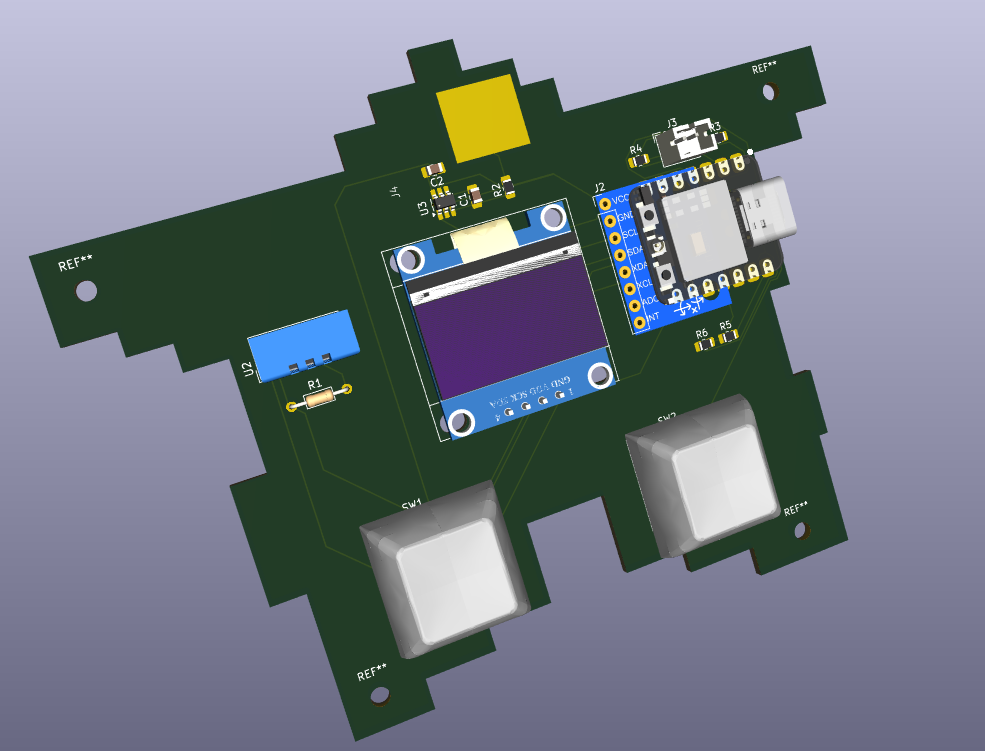

# my-first-hardware-project
**Pet Starbie** 
The Pet Starbie is a small electronic pet I'm designing the idea is from the Tamagotchi device.
I used the Starbie project by [SharKingStudios as my starting point](https://github.com/SharKingStudios/Starbie/blob/main/Week%201%20Guide.md), but I added a few features of my own. I designed the circuit and PCB using KiCad. The controller I used is the XIAO ESP32-C3, and I'm using Arduino IDE to work on the firmware. I designed a custom copper electrode for the touch sensor and added voltage dividers for battery monitoring and USB detection.

**Features**
•	An OLED display to show the pet and its animations.
•	An MPU6050 to detect movement and shaking.
•	Two buttons for interacting with the pet.
•	A DHT11 to measure temperature and moisture.
•	A capacitive touch sensor so the pet can react to being touched.
•	Battery voltage monitoring so the pet can react when the battery is low.
•	USB power detection so the pet can have a different expression when plugged in.

# 3D View of PCB

# PCB Enclosure
