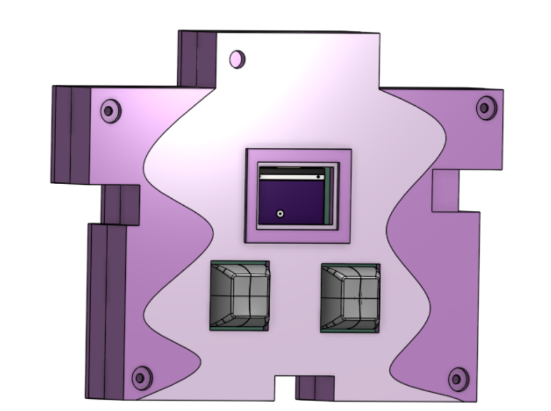

# my-first-hardware-project
**Pet Starbie** 
The Pet Starbie is a small electronic pet I'm designing the idea is from the Tamagotchi device.
I used the Starbie project by [SharKingStudios as my starting point](https://github.com/SharKingStudios/Starbie/blob/main/Week%201%20Guide.md), but I added a few features of my own. I designed the circuit and PCB using KiCad. The controller I used is the XIAO ESP32-C3, and I'm using Arduino IDE to work on the firmware. I designed a custom copper electrode for the touch sensor and added voltage dividers for battery monitoring and USB detection.

**Features**
•	An OLED display to show the pet and its animations.
•	An MPU6050 to detect movement and shaking.
•	Two buttons for interacting with the pet.
•	A DHT11 to measure temperature and moisture.
•	A capacitive touch sensor so the pet can react to being touched.
•	Battery voltage monitoring so the pet can react when the battery is low.
•	USB power detection so the pet can have a different expression when plugged in.

# 3D View of PCB

# PCB Enclosure
 

## Controls

| Control | Function |
|---------|----------|
| Button 1 | First press opens the radial menu. Second press selects the highlighted action. |
| Button 2 | Shows or hides the stats screen. |
| Tilt | While the menu is open, tilt Starbie to move the selector ball to an action. |
| Shake | Shake Starbie to trigger a reaction. |
| Touch | Pet Starbie's head. It jumps, shows hearts, and gets happier. |
| USB-detect | Shows a happy face when plugged in |

# BOM Table
## Bill of Materials (BOM)

| Part | Qty | Unit Price ($) | Vendor |
|---|---:|---:|---|
| 10nF Capacitor | 10 | 0.10 | [DigiKey](https://www.digikey.com/en/products/detail/samsung-electro-mechanics/CL21B103KBANNNC/3886673) |
| 100nF Capacitor | 10 | 0.70 | [DigiKey](https://www.digikey.com/en/products/detail/kemet/C0805F104K5RAC3020/12082500) |
| 0.96 OLED | 4 | 5.99 | [Amazon](https://www.amazon.com/dp/B0GBVWBWCR) |
| MPU6050 | 1 | 6.99 | [Amazon](https://www.amazon.com/dp/B01DK83ZYQ) |
| JST-PH | 10 | 0.10 | [Newark](https://www.newark.com/jst-japan-solderless-terminals/b2b-ph-k-s-lf-sn/header-top-entry-2way-2mm/dp/37K9940) |
| 10k Resistor | 2 | 4.97 | [Amazon](https://www.amazon.com/dp/B0B4JFPHTW) |
| MX Switches | 6 | 0.18 | [Amazon](https://www.amazon.com/dp/B0FQP8VYX4) |
| XIAO ESP32-C3-SMD | 1 | 4.99 | [Seeed Studio](https://www.seeedstudio.com/Seeed-XIAO-ESP32C3-p-5431.html) |
| DHT11 | 1 | 5.99 | [Amazon](https://www.amazon.com/dp/B09TKTZMSL) |
| AT42QT1011-TSHR | 1 | 0.77 | [DigiKey](https://www.digikey.com/en/products/detail/microchip-technology/AT42QT1011-TSHR/2268868) |
| Key Caps | 1 | 11.99 | [Amazon](https://www.amazon.com/dp/B0CQ2XG16M) |
| PCB | 1 | 10.00 | [JLCPCB](https://www.jlcpcb.com/) |
| 200k Resistor | 10 | 0.10 | [DigiKey](https://www.digikey.com/en/products/detail/yageo/AC0805FR-07200KL/6006555) |
| 100k Resistor | 10 | 0.15 | [DigiKey](https://www.digikey.com/en/products/detail/yageo/RE0805FRE07100KL/5923482) |
| 150k Resistor | 10 | 0.15 | [DigiKey](https://www.digikey.com/en/products/detail/yageo/RE0805FRE07150KL/5923504) |
| 1000mAh Battery | 1 | 7.99 | [eBay](https://www.ebay.com/itm/174819689504) |
| M2.5 Hardware | 1 | 9.99 | [Amazon](https://www.amazon.com/dp/B0FG2BYJSR) |
| M3 Hardware | 1 | 8.99 | [Amazon](https://www.amazon.com/dp/B0G11HFYMX) |
| Fabric-over-Foam Gasket | 1 | 16.55 | [Newark](https://www.newark.com/wurth-elektronik/3021008/shielding-gasket-square-1-metre/dp/58T7176) |
| 40-pin Female Header Strip | 1 | 1.95 | [SparkFun](https://www.sparkfun.com/straight-header-female-pth-0-1in-40-pin.html) |
